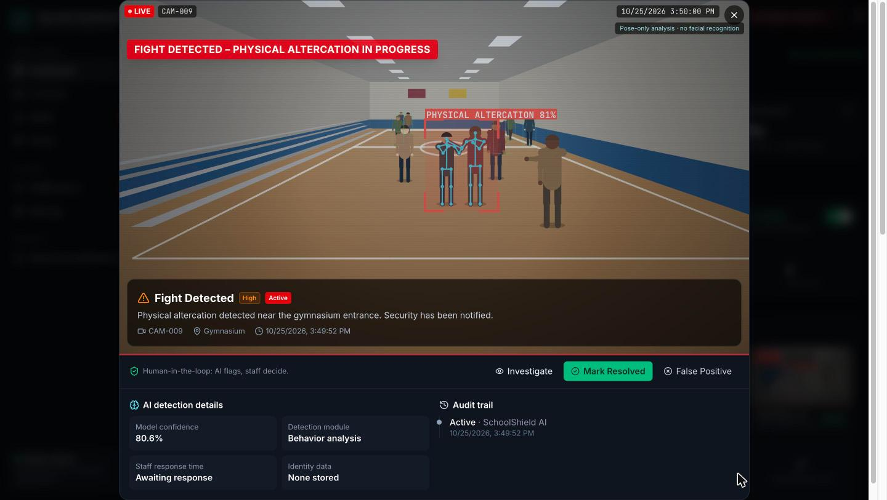
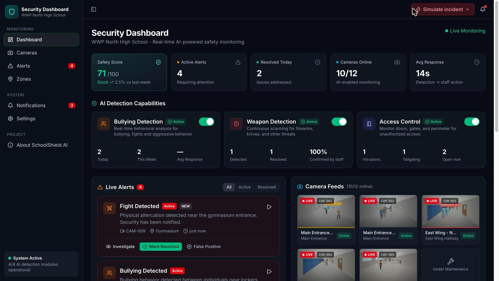
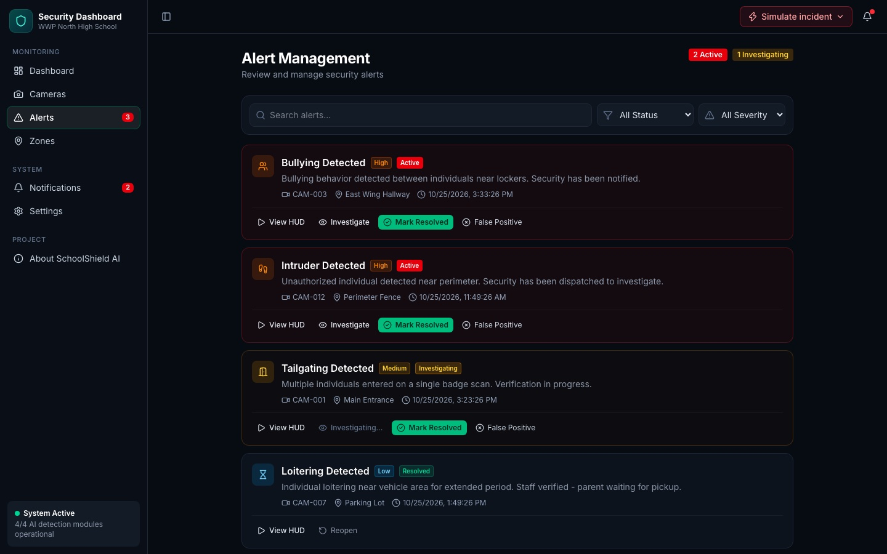
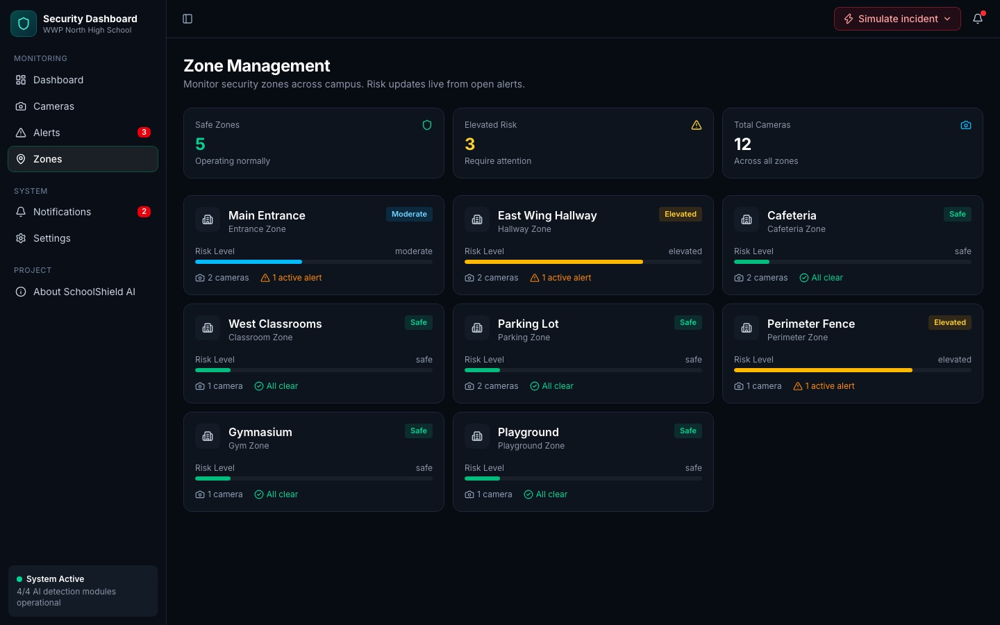
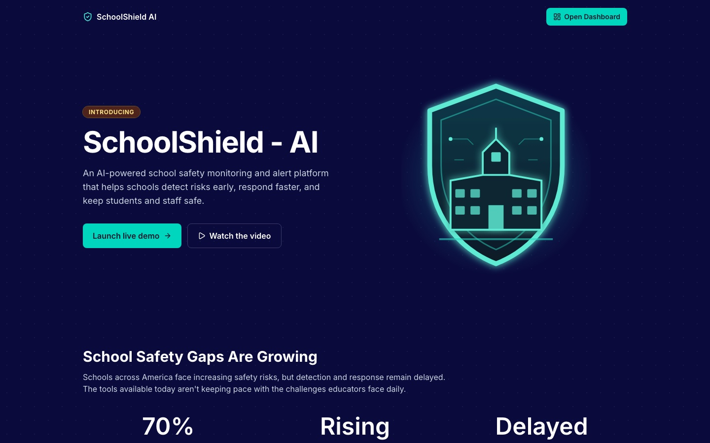
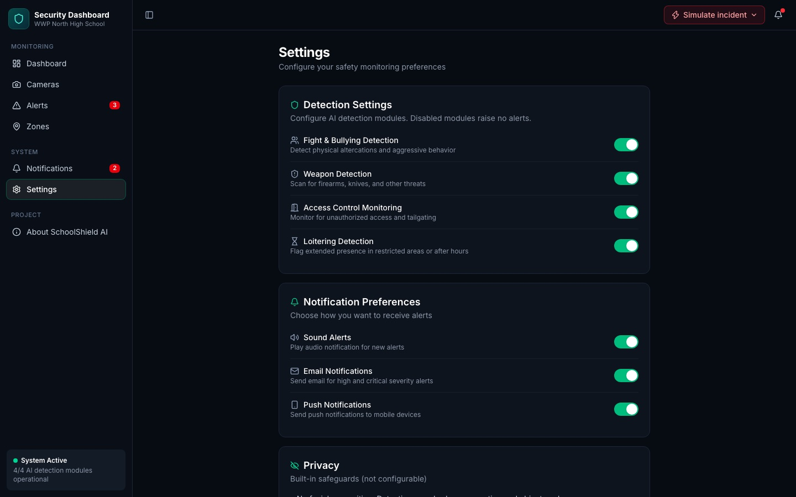

# 🛡️ SchoolShield AI

**Real-time, privacy-first AI school safety monitoring and alerts.**
*Congressional App Challenge 2026 · NJ-12*

[](https://youtu.be/gQtsNemZ-5M)




SchoolShield AI turns the security cameras a school already owns into a **real-time early-warning system**. It flags bullying, fights, tailgating, intruders, loitering and possible weapons in seconds. Then it puts a **human in charge of every decision**.

> 🎥 **Demo video:** https://youtu.be/gQtsNemZ-5M

---

## The problem

Schools have dozens of cameras but only a few people to watch them. Footage is usually reviewed **after** something has gone wrong: after the fight, after the injury, after the video spreads online. The cameras record history; they don't prevent it.

## The solution

| | |
|---|---|
| 🚨 **6 incident types** | Bullying and aggression, physical fights, tailgating, intruders, loitering in restricted areas, possible weapons |
| 🎯 **Severity triage** | Critical / High / Medium / Low, with open, high-severity alerts always on top to avoid alert fatigue |
| 📹 **One-click verification** | Open the live feed with the detection box, pose skeletons and AI confidence |
| 🔒 **Weapon fast path** | A possible weapon opens the feed automatically with a red lockdown banner |
| ✅ **Human-in-the-loop workflow** | Investigate → Resolve, or mark as **False Positive**. Every step is time-stamped in an audit trail |
| 📊 **Live metrics** | Campus Safety Score, average staff response time, AI precision, and zone risk levels |
| ⚙️ **School-controlled** | Turn detection modules on or off, manage cameras, and choose sound, email and push notifications |

## Privacy and security by design

SchoolShield AI is built so students feel **safer, not watched**.

- **Behavior, not identity:** it detects actions and objects, never faces. There's **no facial recognition** and no biometric profiles.
- **Humans decide:** the AI never locks doors, calls police or disciplines anyone on its own. A staff member verifies every alert.
- **Accountable AI:** false positives are recorded and shown as an **AI precision** metric, so the school can see how well the system really performs.
- **Audit trail:** every status change records who made it and when.
- **No student data in the prototype:** there's no backend, no accounts and no tracking. Camera feeds are procedurally drawn stick figures with **no faces**.

## Screenshots

| Security dashboard | Live feed HUD |
|---|---|
|  |  |
| **Alert management** | **Campus zones and live risk** |
|  |  |
| **Project overview** | **School-controlled settings** |
|  |  |

## How it works

```
Camera feed ──▶ Pose + object detection ──▶ Incident classifier ──▶ Severity scoring
                                                                        │
       Audit trail ◀── Staff: Investigate / Resolve / False Positive ◀── Real-time alert + live feed
            │
            └──▶ Safety Score · Avg response time · AI precision · Zone risk
```

In this prototype, the detection stage is **simulated in the browser** by a procedural CCTV renderer (`src/sim/scene.ts`, 800+ lines of Canvas code). That lets anyone run the full detect → verify → respond loop without real student footage.

## Try it yourself (about 2 minutes)

```bash
npm install
npm run dev        # http://localhost:5173
npm run build      # production build in dist/
```

**Demo script**
1. Start on `/`, then click **Launch live demo**.
2. **Simulate incident → Physical fight**. A toast and alert tone fire, and the camera tile turns red.
3. Click **View live feed** to see the detection box, pose skeletons, confidence and audit trail.
4. Click **Investigate**, then **Mark Resolved**. Safety Score, active count, average response and zone risk all update live.
5. **Simulate → Possible weapon**: the feed opens automatically with a red lockdown banner.
6. **Simulate → Loitering**, then mark it **False Positive** to see the AI precision metric update.
7. Turn off a detection module (dashboard toggle or Settings) to show that schools control what is monitored.

Tip: turn on **Auto-generate alerts** in the Simulate menu for a hands-free demo. **Settings → Reset** (or reloading the page) restores the starting data.

### Pages
| Route | What it shows |
|---|---|
| `/` | Project intro (problem, solution, how it works, features, impact) |
| `/dashboard` | Safety score, KPIs, AI detection modules, live alerts, 12 camera feeds |
| `/cameras` | Camera management (online / offline / maintenance) |
| `/alerts` | Alert management with search, status and severity filters |
| `/zones` | Campus zones with live risk levels |
| `/notifications` | Notification feed |
| `/settings` | Detection modules, notification preferences, demo controls |

### Using real footage
To use your own clips instead of the simulated feeds, add a `clipUrl` to a camera in `src/data/mock.ts` (e.g. `clipUrl: '/clips/cam-003.mp4'`) and put the file in `public/clips/`. The AI overlays (LIVE badge, banner, alert panel) still render on top.

## Tech stack

- **React 19 + TypeScript** with React Router for the 7-page app
- **Vite 8** for the dev server and build, **Tailwind CSS v4** for styling, **Lucide** icons
- **HTML Canvas** for the procedural CCTV renderer (scenes, people, pose skeletons, detection boxes)
- **Web Audio API** for severity-specific alert tones
- A central React-context **safety store** that keeps the dashboard, alerts, zones, cameras and notifications in sync

```
src/
├── pages/        Landing, Dashboard, Cameras, Alerts, Zones, Notifications, Settings
├── components/   CameraFeed, CameraGrid, IncidentModal (HUD), AlertCard, Toaster, Layout
├── sim/scene.ts  Procedural CCTV renderer (no faces drawn)
├── store/        SafetyStore: single source of truth
├── lib/          metrics (safety score, response time, precision, zone risk), sound, format
└── data/mock.ts  Cameras, zones, seed alerts
```

## Roadmap (v2.0)

- Real on-premises computer vision (RTSP streams + YOLO-style pose and weapon detection), so **video never leaves the school**
- Mobile app for staff and School Resource Officers, with an "I'm responding" button and nearest-responder routing
- Anonymous student reporting linked to the same incident dashboard
- One-tap lockdown and integration with door-access systems
- Published fairness and accuracy audits, auto-blurring of uninvolved students, retention limits, and FERPA-aligned access controls
- A pilot with a local school to measure real response-time improvements

## Team

| Name | Grade | School |
|---|---|---|
| Dev Shaurya Dosapati | 11 | West Windsor-Plainsboro High School North |
| Devi Snigdha Dosapati | 10 | West Windsor-Plainsboro High School North |
| Saadhana Dara | 11 | Old Bridge High School |

Built for the **Congressional App Challenge 2026** (New Jersey's 12th District).
AI assistance: Anthropic's Claude (Claude Code) was used as a coding assistant. The team designed, reviewed, tested and finalized the app.
